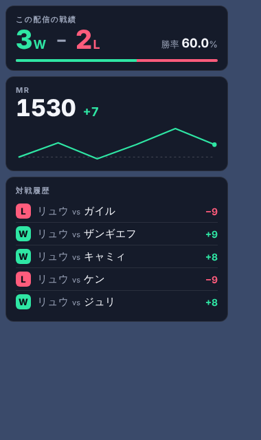

# SF6 Tracker

OBS に映っているストリートファイター6の画面**だけ**を見て、勝敗・対戦キャラ・レート（MR / LP）を読み取り、
配信画面に「戦績」「レート推移」「対戦履歴」を出すツールです。

- 情報源は OBS のキャプチャ映像のみ。カプコンのサーバーや Buckler's Boot Camp など外部サイトには一切アクセスしません。
- 読み取った結果と履歴はこの PC の `data/` フォルダにだけ保存されます。
- 対戦履歴は設定した保持時間で自動削除します（0は無期限、件数上限なし）。自分の使用キャラが変わった場合は履歴と戦績・レート推移を自動リセットします。どちらも設定画面で変更でき、バックアップは作成しません。



## しくみ

```
OBS（SF6 のソース）──WebSocketでスクリーンショット──▶ SF6 Tracker ──▶ ブラウザソース（オーバーレイ）
                                                        │            └▶ カスタムブラウザドック（操作パネル）
                                                        └ 文字認識（OCR）で VS画面 / WIN・LOSE / レートを判定
```

OBS 28 以降に標準で入っている WebSocket サーバーを使うので、OBS に追加プラグインは不要です。

## はじめかた（Windows）

1. [Python 3.10 以降](https://www.python.org/) を入れる（インストール時に「Add python.exe to PATH」にチェック）。
2. OBS の **ツール → WebSocketサーバー設定** で「WebSocketサーバーを有効にする」をオン。パスワードを控える。
3. `start.bat` をダブルクリック（初回だけ部品のインストールで数分かかります）。
4. ブラウザで <http://127.0.0.1:17860/control> を開き、**設定** タブで OBS のパスワードを入れて保存 → 「SF6 のソース」でゲームキャプチャ（または映像キャプチャデバイス）を選んで保存。
5. OBS に **ブラウザソース** を追加し、URL を `http://127.0.0.1:17860/overlay`（幅 360 / 高さ 720 目安）にする。
6. お好みで **ドック → カスタムブラウザドック** に `http://127.0.0.1:17860/control` を登録すると、OBS の中で履歴の修正ができます。

### OBS から起動・停止する

1. 一度 `start.bat` を実行して部品のインストールを済ませる（そのあと閉じて OK）。
2. OBS の **ツール → スクリプト** で「＋」を押し、このフォルダの `obs\sf6-tracker.lua` を追加。
3. スクリプトを選ぶと右側に **▶ トラッカーを起動 / ■ トラッカーを停止** のボタンが出ます。黒いウィンドウは出ず、裏で動きます。

- **ホットキー**: OBS の 設定 → ホットキー に「SF6 Tracker を起動 / 停止」が追加されるので、好きなキーを割り当てられます。
- **自動起動**: SF6 以外のゲームのときに動かないよう、既定ではオフです。毎回起動したい人は「OBS の起動時に自動で起動する」にチェック。
- OBS から起動したトラッカーは、OBS を閉じると自動で止まります。

配置だけ先に決めたいときは `http://127.0.0.1:17860/overlay?demo=1` で見本データが出ます。

### オーバーレイの見た目を決める

`http://127.0.0.1:17860/overlay?setup=1` をブラウザで開くと、見た目を選ぶ画面が出ます。並べ方（縦 / 横並び）、出す部品、背景の色・濃さ・なし、文字色、大きさなどを選ぶと下に URL ができるので、それを OBS のブラウザソースに貼ります。

部品をバラバラの場所に置きたいときは、同じ画面の「部品をバラバラの場所に置きたいとき」に部品ごとの URL が出ます。部品ごとにブラウザソースを作れば、OBS 上で 1 つずつ自由に動かせます。

| URL オプション | 意味 |
|---|---|
| `layout=row` | 横並び（既定は縦 `column`） |
| `panels=score,rating,history` | 出す部品（戦績 / レート / 履歴）と順番 |
| `limit=8` | 履歴の数 |
| `scale=1.3` | 大きさ |
| `scope=session` | 集計範囲。`session`（この配信）/ `today` / `all` |
| `align=right` | 右寄せ |
| `me=0` | 自分のキャラ名を隠す |
| `bg=1b2030` / `bg=none` | 背景色（16 進 6 桁）／ 背景なし（文字だけ） |
| `alpha=0.82` | 背景の濃さ（0〜1） |
| `theme=light` | 黒文字（明るい背景向け） |
| `radius=12` | 角の丸み |
| `demo=1` | 見本データで表示 |

### ボタン入力の表示

押しているボタンとレバーの向きを、コントローラーの絵の上で光らせて配信画面に出せます。

- 操作パネルの **入力表示** タブ（または `http://127.0.0.1:17860/input?setup=1`）で、タイプ（ゲームパッド / レバーレス / レバーアケコン）、色、大きさを選び、ボタンの割り当てを「設定」→ コントローラーのボタンを押す、で変更できます。
- 下に出る URL を OBS のブラウザソースに貼ります。コントローラーのボタンを 1 回押すと表示が始まります。
- 既定の割り当ては SF6 クラシック（□/X=LP、△/Y=MP、R1/RB=HP、×/A=LK、○/B=MK、R2/RT=HK）。
- 方向は十字キー、左スティック、DirectInput のハット（レバー）で読みます。キーボードモードのレバーレスは「キーボード・マウス」を選び、表示したいキーを割り当ててください。
- ボタンは設定画面のプレビュー上でドラッグして移動できます。「＋ ボタンを追加」で最大32個まで追加でき、各ボタンの「削除」で取り除けます。配置も含めてURLに保存されるので、変更後のURLをOBSに貼り直してください。
- 入力表示の設定は自動保存され、開き直すと復元されます。URLの指定は保存済み設定より優先します。パッドには左右アナログスティックを表示し、Windowsネイティブ版の「キーボード・マウス」では任意キー、マウス5ボタン、ホイール上下・左右を割り当てられます。
- Windows のネイティブ版は XInput / DirectInput から直接入力を取るため、ゲームを操作している間も表示できます。Python版・旧ネイティブ版では従来どおりブラウザのGamepad APIを使用します。

## 認識のしかたと調整

1 秒ごと（変更可）に画面を 1 枚もらい、次を探します。

| 見るもの | 既定の判定 | 使いみち |
|---|---|---|
| VS 画面 | `VS` の文字、または両側にキャラ名 | 対戦キャラを覚える |
| 勝敗 | `WIN` / `LOSE` の文字（両方あるときは自分の側にある方） | 2 回続けて見えたら 1 戦として記録 |
| レート | `MR`（または `LP`）の近くの数字 | 変動前→変動後を読んで増減を計算 |

### 1P / 2P の自動判定

1P と 2P は試合ごとに入れ替わるので、**設定** タブで自分の**プレイヤーネーム**を登録しておくと、画面に出ている名前の位置（左 = 1P、右 = 2P）から毎試合どちらが自分かを判定し、自分のキャラ・相手のキャラ・勝敗を正しい向きで記録します。

1. プレイヤーネームが画面で読めたら、その側が自分。
2. 読めなかったら、登録した**使用キャラ**が片側だけにいれば、その側が自分。
3. どちらでも決まらないときだけ「判定できないときの側」を使用（履歴に `1P?` のように `?` 付きで表示）。

最初は**画面全体**から探します。うまく読めない・誤検出するときは、操作パネルの **画面の調整** タブで：

- スライダーで直近 2 分の画面をさかのぼり、VS 画面やリザルト画面で止める（スクリーンショット画像を開くこともできます）。
- 「この画面で試す」で、何が読めているかを確認。
- 項目を選んで画面上をドラッグすると、その項目を見る**枠**を決められます（枠を絞るほど正確で軽くなります）。
- 文字として読めない演出は「今の絵を登録」で**目印の絵**として覚えさせられます。
- 名前が読めなかったキャラは **履歴** タブに画像が出るので、一度名前を選べば次から自動で判定します。

間違って記録されたものは **履歴** タブで勝敗・キャラ・レートを直せます（削除・手動追加も可）。

勝敗画面を取り逃しても、対戦中に確認した自分のLP/MRと、次のVS画面・対戦HUDで3回続けて読めた値を比較して補完します。増加は勝ち、減少は負けとして「レート変動から補完」のメモ付きで保存します。使用キャラやレート種類の変更、通常記録との二重保存は除外します。前後の数値が読めない場合や、値が変わらない試合は補完できません。

録画ファイルで試すとき：`start.bat --file 録画.mp4`（画像 1 枚や画像フォルダも可）。

## 現状の注意

- 認識の初期設定は実際の SF6 の映像ではまだ確認できていません（絵で作ったテスト画面では動作確認済み）。
  実際の VS 画面・リザルト画面のスクリーンショットか短い録画があれば、既定の枠としきい値を合わせ込めます。
- プレイヤーネームに日本語（かな・漢字）が入っていると文字認識で読めないことがあります。そのときは使用キャラの登録か、プレイヤー名の枠の調整で補います。
- 同じ相手との連戦で VS 画面が出なかった場合は、直前のキャラを引き継ぎます（履歴に「連戦」と表示）。

## 開発

```
pip install -r requirements.txt
python tests/test_detector.py     # 絵で作った画面で認識の流れを確認
python -m sf6tracker --data data  # 起動
```

| ファイル | 役割 |
|---|---|
| `sf6tracker/capture.py` | OBS WebSocket から画面を取得（録画ファイル再生も） |
| `sf6tracker/vision.py` | 枠の切り出し、OCR、絵の比較、キャラ名・レートの解釈 |
| `sf6tracker/detector.py` | VS → 対戦 → リザルト の流れを追って 1 戦を記録 |
| `sf6tracker/store.py` | 履歴の保存と集計 |
| `sf6tracker/server.py` / `web/` | オーバーレイ・操作パネル・ローカル API（127.0.0.1 のみ） |
